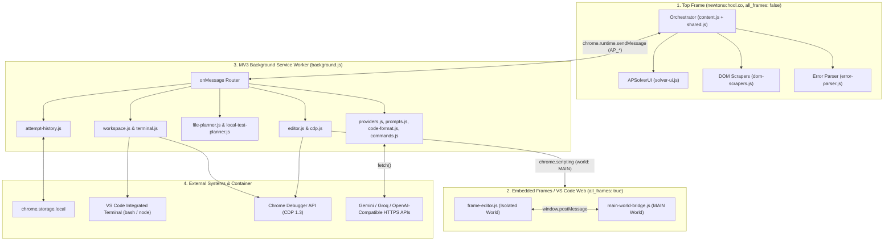
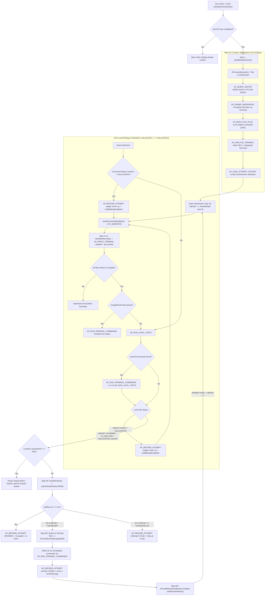
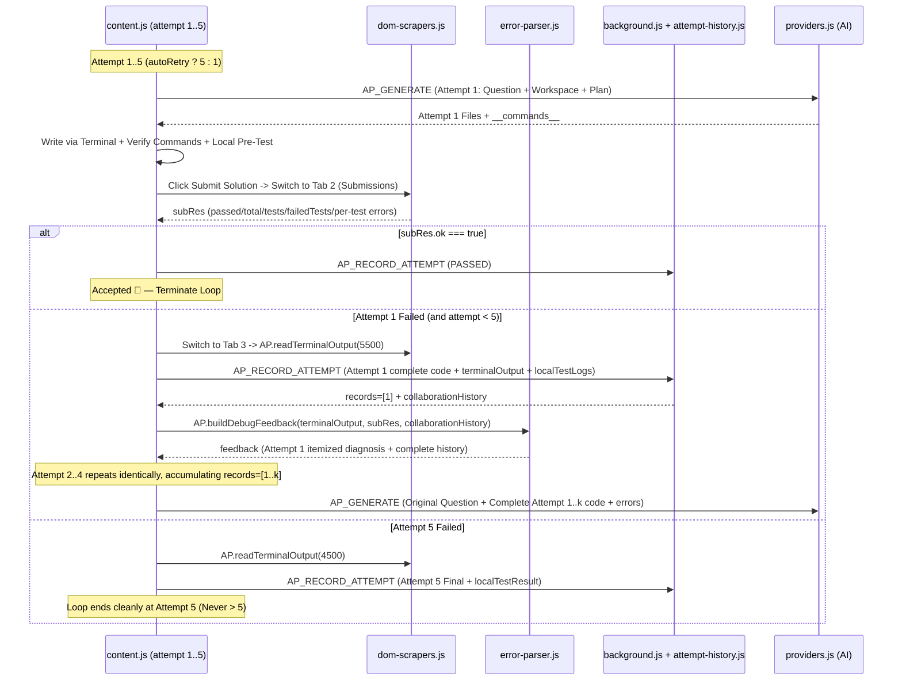

# AP-Solver — Complete System Architecture & End-to-End Execution Flow

> This document describes **actual, implemented runtime behavior** verified directly across the current AP-Solver codebase, explicitly distinguishing fully functional pipelines from partially wired, legacy, or fallback-limited behaviors.

---

## 1. Project Overview

**AP-Solver** (`manifest_version: 3`) is an autonomous Chrome Extension AI coding copilot built for 3-section browser coding environments on `newtonschool.co` (left panel: Question / Submissions / Grader Output; middle pane: embedded VS Code Web / Monaco + Integrated Terminal; right pane: HTTP Request tester).

### Purpose & Capabilities
1. **Scrapes problem context & container workspace** (requirements, test case names, starter code, `package.json`, `.env`, `nodemon.json`, `README.md`, and any existing grading test files).
2. **Locks a deterministic File Modification Plan** before generating code so existing nested workspace files are modified in-place while protected config/test files cannot be clobbered.
3. **Generates multi-file solutions via cloud LLM APIs** (Google Gemini, Groq, or OpenAI-compatible endpoints) using Turbo Race mode or single-provider mode.
4. **Writes files directly to container disk via the Integrated Terminal** (`base64` shell decoding + Git commit), avoiding Monaco editor line corruption.
5. **Executes and verifies post-write terminal commands** (`npm install`, `npm run build`, `npx prisma db push`, `npx prisma generate`, `seed.js`, etc.) and **question-specific local pre-tests** in Terminal before remote submission.
6. **Submits and runs a cumulative 5-attempt AI correction loop** (`Attempt 1..5`) that preserves every previous attempt's complete source code, executed commands, local check results, and remote error traces without overwriting earlier attempts.

### Major Component Map
| Directory / File | Role |
| :--- | :--- |
| [manifest.json](manifest.json) | MV3 permissions (`storage`, `scripting`, `activeTab`, `clipboardWrite`, `clipboardRead`, `debugger`), `background.js` service worker, and content scripts. |
| [background.js](background.js) | Service worker message router (`chrome.runtime.onMessage`) for `AP_*` operations. |
| [background/cdp.js](background/cdp.js) | Chrome DevTools Protocol (`chrome.debugger`) native mouse clicks, keyboard events (`keyDown`/`char`/`keyUp`), chunked `Input.insertText`, visual target beacons, and VS Code file/tab navigation. |
| [background/editor.js](background/editor.js) | Cross-frame `MAIN`-world Monaco reader (`queryEditorInTab`) and manual single-file inject fallback (`writeEditorInTab`). |
| [background/terminal.js](background/terminal.js) | Integrated Terminal panel opener (`ensureTerminalOpen`), frame coordinate locator (`findTerminalFrameInfo`), 3-tier command injector (`dispatchCommandToTerminal`), xterm/DOM/React-fiber buffer reader (`readIntegratedTerminalText`), command output capture (`runTerminalCommandWithCapture`), and file writer (`writeFilesViaTerminal`). |
| [background/workspace.js](background/workspace.js) | Container filesystem probe (`probeWorkspaceViaTerminal`), local verification harness (`buildLocalTestRunnerScript`, `runLocalTestsViaTerminal`), and verified terminal command runner (`runTerminalCommandsViaTerminal`). |
| [utils/llm.js](utils/llm.js) | Barrel re-export module aggregating all `utils/*` exports. |
| [utils/file-planner.js](utils/file-planner.js) | Pre-implementation file analyzer (`analyzeFileModificationPlan`) and post-generation gate (`enforceFilePlan`). |
| [utils/local-test-planner.js](utils/local-test-planner.js) | Question-specific verification strategy & probe builder (`buildLocalTestSpec`). |
| [utils/attempt-history.js](utils/attempt-history.js) | Pre-coding terminal analyzer (`analyzePreCodingTerminal`), failure classifier (`classifyFailureCategory`), code diff summarizer (`summarizeCodeChanges`), attempt builder (`buildAttemptRecord`), cumulative prompt formatter (`formatFullCollaborationHistory`), and `chrome.storage.local` persistence. |
| [utils/commands.js](utils/commands.js) | Command sanitizer (`sanitizePostWriteCommand`), `__commands__` extractor (`extractCommandsFromResponse`), auto-remediation detector (`detectRequiredPostWriteCommands`), and atomic base64 script builder (`buildBase64TerminalScript`). |
| [utils/code-format.js](utils/code-format.js) | Comment stripping (`stripComments`), 2-space indenter (`formatCodeIndentation`), static asset path alignment (`alignStaticFilePaths`), canonical deduplication (`dedupeCanonicalFiles`), and multi-file parser (`parseMultiFileSolution`). |
| [utils/prompts.js](utils/prompts.js) | Spec-driven & cumulative prompt builder (`buildPrompt`), context-gated system prompt (`getContextGatedSystemPrompt`), and Groq TPM compactor (`buildCompactGroqMessages`). |
| [utils/providers.js](utils/providers.js) | `DEFAULT_SETTINGS`, Chrome storage helpers, `callGemini`, `callGroq`, `callOpenAI`, and `generateSolution` (Turbo Race & Debug Escalation). |
| [content/shared.js](content/shared.js) | Top-frame `window.__AP` DOM utilities, comment stripper, and top-frame copy of bash script/command builders. |
| [content/dom-scrapers.js](content/dom-scrapers.js) | Scrapers for Question (`extractQuestion`), Submit button (`getSubmitButton`), Submissions Tab 2 (`readSubmissionResultsWithErrors`), Left-rail tab switchers, and Terminal Tab 3 (`readTerminalOutput`). |
| [content/error-parser.js](content/error-parser.js) | Mocha/Jest/ANSI/PENDING log parser (`parseAndStructureFailures`), error classifier (`classifyErrorCategory`), root-cause diagnoser (`diagnoseErrorMessage`), and `buildDebugFeedback`. |
| [content/solver-ui.js](content/solver-ui.js) | Floating copilot UI widget (`APSolverUI`, mounted at `#ap-solver-host`) with log console, inline key drawer, file cards, and terminal script copy button. |
| [content/content.js](content/content.js) | Top-frame autonomous 6-step orchestrator and 5-attempt solving loop (`handleOneClickSolve`). |
| [content/frame-editor.js](content/frame-editor.js) & [content/main-world-bridge.js](content/main-world-bridge.js) | All-frame listener & page-world bridge used during DOM/Monaco/xterm fallback messages (`AP_WRITE_EDITOR`, `AP_INJECT_TERMINAL_COMMAND`, `AP_CLEAN_EDITOR_ARTIFACTS`). |
| [popup/popup.html](popup/popup.html), [popup/popup.js](popup/popup.js), [options/options.html](options/options.html), [options/options.js](options/options.js) | Extension popup (onboarding + quick toggles + API connection test) and full settings page. |

---

## 2. Architecture & Component Interaction

AP-Solver operates across **four isolated Chrome Extension contexts**:

### Primary Background Message Operations (`background.js`)
| Message `op` | Handler / Target Module | Purpose |
| :--- | :--- | :--- |
| `AP_KEEPALIVE` | Inline response | Ping sent every `20s` during long AI requests to prevent MV3 service worker suspension. |
| `AP_GET_SETTINGS` / `AP_SAVE_SETTINGS` | `providers.js` | Reads or merges settings in `chrome.storage.local`. |
| `AP_QUERY_EDITOR` | `background/editor.js` (`queryEditorInTab`) | Injects `MAIN`-world probe into VS Code iframe to read active file code, file tree, and open Monaco models. |
| `AP_PROBE_WORKSPACE` | `background/workspace.js` (`probeWorkspaceViaTerminal`) | Executes base64 Node probe in container terminal to fetch `package.json`, `.env`, `nodemon.json`, `README.md`, tests, and disk file tree. |
| `AP_BUILD_FILE_PLAN` | `utils/file-planner.js` (`analyzeFileModificationPlan`) | Locks allowed edit/create file targets and protected files before code generation. |
| `AP_ENFORCE_FILE_PLAN` | `utils/file-planner.js` (`enforceFilePlan`) | Pre-write runtime filter dropping unapproved/protected/duplicate paths. |
| `AP_ANALYZE_TERMINAL` | `utils/attempt-history.js` (`analyzePreCodingTerminal`) | Extracts pre-existing terminal errors, required build/migration commands, and git/env notes before Attempt 1. |
| `AP_READ_INTEGRATED_TERMINAL` | `background/terminal.js` (`readIntegratedTerminalText`) | Reads current xterm buffer/DOM/a11y/React-fiber text from VS Code terminal. |
| `AP_LOAD_ATTEMPT_HISTORY` / `AP_RECORD_ATTEMPT` / `AP_SAVE_ATTEMPT_HISTORY` | `utils/attempt-history.js` | Loads, builds, diffs (`summarizeCodeChanges`), persists, and formats cumulative history (`formatFullCollaborationHistory`). |
| `AP_GENERATE` | `utils/providers.js` (`generateSolution`) | Runs Turbo Race or Debug Escalation, parses multi-file code, extracts `__commands__`, and enforces file plan. |
| `AP_WRITE_TERMINAL` | `background/terminal.js` (`writeFilesViaTerminal`) | Opens terminal, acquires focus (blocking Monaco leaks), dispatches single-line base64 write script, and checks completion marker. |
| `AP_RUN_TERMINAL_COMMANDS` | `background/workspace.js` (`runTerminalCommandsViaTerminal`) | Executes post-write/remediation shell commands in project root and returns verified exit codes and output. |
| `AP_RUN_LOCAL_TESTS` | `background/workspace.js` (`runLocalTestsViaTerminal`) | Generates `localTestSpec`, writes self-contained Node verification runner, executes compilation + test suite / live HTTP / exports / CLI checks in Terminal, and decodes gzip telemetry. |
| `AP_WRITE_EDITOR` | `background/editor.js` (`writeEditorInTab`) | Manual single-file inject handler triggered only from UI card `⚡ Inject` buttons. |
| `AP_CLEAN_EDITOR_ARTIFACTS` | `frame-editor.js` -> `main-world-bridge.js` | Strips stray shell commands from Monaco models if present. |

---

## 3. Initialization & Configuration Loading

1. **Extension Install / Update (`background.js` lines 26–32):**
   - `chrome.runtime.onInstalled` inspects `getSettings()`. If `provider` is empty, it defaults to `'race'`.
2. **Default Settings ([utils/providers.js](utils/providers.js#L8-L20)):**
   - `provider: 'race'`, `geminiModel: 'gemini-2.5-flash'`, `groqModel: 'openai/gpt-oss-120b'`, `openaiModel: 'gpt-4o'`, `openaiBaseUrl: 'https://api.openai.com/v1'`, `autoSubmit: true`, `autoRetry: true`, `maxRetries: 5`.
3. **Top-Frame Initialization (`init()` in [content/content.js](content/content.js#L1189-L1268)):**
   - Guarded by top-frame + `newtonschool.co` hostname check and `window.__apContentLoaded`.
   - Loads settings directly from `chrome.storage.local.get(null)` (falling back to `AP_GET_SETTINGS`).
   - Instantiates `window.APSolverUI` mounting `#ap-solver-host` on `document.documentElement`. If neither `geminiKey` nor `groqKey` is set, `showSettings` opens the inline key drawer automatically.
   - Resolves `activeProvider`: preserves explicit `'openai'` when `openaiKey` exists; prefers `'race'` (or user's `'gemini'`/`'groq'`) when both keys exist; falls back to whichever single key is configured.
   - **Disconnection note in UI:** `init()` starts a startup interval (`12` polls × `800ms`) calling `ui.updateProblemInfo(...)` with scraped `title`, `difficulty`, `points`, `testCasesCount`. In [solver-ui.js](content/solver-ui.js#L239-L241), `renderBodyContent()` is an empty function, so `problemInfo` fields are stored in memory but never displayed inside the floating card.
4. **Popup & Options Initialization:**
   - [popup/popup.js](popup/popup.js): Displays an onboarding view when all three API keys are empty, or the main quick-toggle/test view when any key exists. Clicking `⚡ Test API Connection` invokes `AP_GENERATE` directly with a tiny hello-world prompt.
   - [options/options.js](options/options.js): Maps legacy model strings (`/1\.5|3\.5|3\.8/` for Gemini -> `gemini-2.5-flash`; `/llama|mixtral|3\.8-27b/` for Groq -> `openai/gpt-oss-120b`) and stores custom OpenAI-compatible `openaiBaseUrl` / `openaiModel`.
5. **All-Frame Monaco Bridge Injection ([content/frame-editor.js](content/frame-editor.js)):**
   - Injects `content/main-world-bridge.js` via `<script src="chrome-extension://...">` in every matching frame so `window.monaco` is reachable on demand.

---

## 4. Complete End-to-End Execution Flow

### Detailed Step Breakdown inside `handleOneClickSolve()`
1. **Step 1/6 — Context Reading (`handleReadContext()`, [content.js](content/content.js#L254-L391)):**
   - Switches to Tab 1 (`Question`), scrapes `title`, `difficulty`, `points`, `testCases`, and `details` via `AP.extractQuestion()`. If Submissions Tab 2 already contains test rows, `cachedQuestion.testCases` adopts those exact names.
   - Queries the active editor via `AP_QUERY_EDITOR` (`cachedEditor`), then probes container disk via `AP_PROBE_WORKSPACE`. Disk paths take precedence and bare duplicate DOM tab names are removed (`pruneBareTabDuplicates`).
   - Builds `lockedFilePlan` via `AP_BUILD_FILE_PLAN` (`analyzeFileModificationPlan`).
   - Reads side terminal (`AP.readTerminalOutput(1600)`), restores Question tab, reads integrated terminal (`AP_READ_INTEGRATED_TERMINAL`), and runs `AP_ANALYZE_TERMINAL`.
   - Loads any unsolved persistent attempt history via `AP_LOAD_ATTEMPT_HISTORY`, populating both `sessionAttemptRecords` and `sessionCollaborationHistory`.
   - Captures initial workspace baseline (`initialWorkspaceFiles`, `initialReferenceFiles`) so starter files untouched by the AI are protected from accidental clobbering.

2. **Outer Loop (`attempt = 1 .. maxAttempts`, max `5` when `autoRetry` is enabled; `1` otherwise):**
   - Sets `currentAttemptNum = attempt`, resets per-attempt `lastLocalTestResult = null`.
   - Enters inner loop `localTry = 1 .. maxLocalTries` (`3` if `autoRetry`, else `1`).

3. **AI Code Generation (`handleGenerate(feedback)` -> `AP_GENERATE`):**
   - Merges starter `referenceFiles` with latest generated files in `cachedGeneratedFiles`.
   - Calls `AP_GENERATE` (`deadlineAt`: `85s` initial / `120s` debug) alongside a `20s` `AP_KEEPALIVE` heartbeat interval.
   - Merges returned files into `cachedGeneratedFiles`, prevents overwriting an untouched thin root loader `index.js`, queues superseded flat AP-generated duplicates into `staleTempFilesToRemove`, updates UI file cards (`ui.setGeneratedFiles`), and caches parsed `// __commands__`.

4. **Step 2 & 3/6 — Pre-Write Gate, Disk Write & Post-Write Commands (`handleWriteCode()`, [content.js](content/content.js#L524-L665)):**
   - Re-verifies `filesToWrite` against `lockedFilePlan` via `AP_ENFORCE_FILE_PLAN`.
   - Strips comments from non-static assets via `AP.stripAllComments()`.
   - Collects post-write commands (`cachedCommands` + `AP.detectPostWriteCommands()` + `terminalPreAnalysis.requiredPostCommands`).
   - Builds two scripts with `AP.buildTerminalBashScript`: a full clipboard script (for manual paste fallback) and an `automatedWriteScript` (file write cleanly first when `mergedPostCmds.length > 0`).
   - Dispatches `AP_WRITE_TERMINAL` up to 2 attempts. Once `filesWrittenViaTerminal = true`, if `mergedPostCmds.length > 0`, runs them through `AP_RUN_TERMINAL_COMMANDS` to obtain real exit codes and output.
   - `verifyCodeCompleteness()` checks non-placeholder lengths (`>= 5` static assets, `>= 12` code) and verifies zero bash command leaks inside code.

5. **Pre-Submit Local Testing (`AP_RUN_LOCAL_TESTS`):**
   - If a required post-write command failed (`writeResult.commandFailure`), records `local-<attempt>.<localTry>`, builds debug feedback, and retries locally without submitting.
   - Otherwise calls `AP_RUN_LOCAL_TESTS` with full question details, test case names, workspace files, `package.json`, and `terminalPreAnalysis`.
   - If `autoFixCommands` are returned on local failure (e.g., missing npm package or uninitialized Prisma client), runs them once via `AP_RUN_TERMINAL_COMMANDS` (deduplicated via `remediatedCmds`) and re-runs `AP_RUN_LOCAL_TESTS`.
   - Logs strategy, commands run, and up to 10 individual test cases to UI console. On failure (when `localTry < maxLocalTries`), records `local-<attempt>.<localTry>` cleanly and generates `feedback` for another local AI fix pass instead of clicking Submit.

6. **Step 4/6 — Remote Submission & Polling (`handleSubmit()` -> `submitAndMonitor()`, [content.js](content/content.js#L144-L252)):**
   - Skips submission cleanly if `ui.options.autoSubmit === false`.
   - Otherwise clicks Newton's Submit button, switches to Submissions tab, waits `3.5s`, polls every `500ms` up to `120s`, ignoring stale prior results for up to `8s` unless running indicators were seen.

7. **Step 5 & 6/6 — Failure Analysis & Escalation ([content.js](content/content.js#L1065-L1168)):**
   - On `subRes.ok`: records `PASSED` via `AP_RECORD_ATTEMPT`, marks solved, stops loop.
   - On failure with `attempt < maxAttempts`: switches to Terminal Tab 3, reads grader trace (`AP.readTerminalOutput(5500)` or Tab 2 per-test error fallback), runs any remote auto-remediation commands, calls `AP_RECORD_ATTEMPT` storing complete files + errors + `localTestLogs`, runs `AP.buildDebugFeedback()` with full `sessionCollaborationHistory`, switches back to Question tab, sleeps `1.5s`, and advances to `attempt + 1`.
   - On final Attempt 5 failure: records final attempt snapshot (including `localTestResult`), logs final score, sets `ui.setRunning(false)`, and terminates cleanly.

---

## 5. Local Component Deep Dive

### Important Clarification
AP-Solver does **not** run a local neural network/LLM (e.g., Ollama or WebLLM). Its "local component" is a **deterministic pre-planning + in-container runtime test engine** operating locally in Node/Chrome before remote submission.

### Subcomponents & Responsibilities
1. **Locked File Modification Planner ([utils/file-planner.js](utils/file-planner.js)):**
   - `analyzeFileModificationPlan()` inventories all workspace files, identifies thin root wrappers (`index.js` `<140` chars requiring `./src/index`), protects config/test files (`package.json`, `.env`, `nodemon.json`, `__tests__/*`, `*.test.*`), resolves explicit file mentions and starter `require()`/`import` targets, matches generic roles (`service.js` -> `src/services/ride.service.js`), and locks `allowedPaths`.
   - `enforceFilePlan()` runs two-pass matching (Pass 1 exact canonical matches; Pass 2 deterministic remapping onto unclaimed plan targets or blocking duplicates/invented siblings).
2. **Question-Specific Local Test Strategy Builder ([utils/local-test-planner.js](utils/local-test-planner.js)):**
   - `detectRuntimeEnvironment()` detects `language` (`javascript`, `typescript`, `python`), `moduleSystem` (`commonjs` vs `esm`), `framework` (`express`, `node-http`, `node-http-static`, `prisma-node`, `node-cli`, `python-cli`), `entryFile`, existing test dirs (`__tests__`, `test`, `tests`, root `*.test.js`), and build commands (`npm run build`, `npx tsc --noEmit`, `npx prisma validate`).
   - Extracts deterministic checks:
     - `extractFileContentChecks()`: required `.html`/`.css`/`.txt` files and expected text content.
     - `extractExpectedModuleExports()`: required exported symbols tied to specific JS modules.
     - `extractHttpProbes()`: static HTML routes, explicit `GET`/`POST`/`PUT`/`PATCH`/`DELETE` routes, unauthenticated protected routes expecting `401`/`403`, missing body checks expecting `400`/`422`, malformed JSON crash resistance (`< 500`), and `404` unknown route handling.
     - `extractSampleIoCases()`: stdin/stdout blocks for non-HTTP CLI problems.
3. **In-Terminal Test Harness (`buildLocalTestRunnerScript()` in [background/workspace.js](background/workspace.js#L87-L618)):**
   - Encodes as base64 and pipes into `node` inside container terminal (`cd /app/code` root-anchored).
   - Executes in 4 phases:
     - **Disk Check (`rawDiskCheck`):** Ensures every target file written actually exists on disk.
     - **Phase 1 (Compilation / Syntax):** `python3 -m py_compile`, `node --check` on every `.js`/`.mjs`/`.cjs` file, `npm run build` / `tsc --noEmit` (when TS binary exists), `npx --no-install prisma validate`.
     - **Phase 2 (File / Asset Checks):** Reads required static/HTML files and verifies expected content.
     - **Phase 3 (Project Test Suite):** Runs `npm test` or `npx -y mocha ...` when test files are present locally on disk.
     - **Phase 4 (Question-Specific Runtime / HTTP / Exports / CLI):** When Newton holds `__tests__/` remotely (`needsMissingTestDir`), runs Python/Node CLI stdin/stdout cases OR spawns an isolated child `node` process (`NODE_ENV=test PORT=0`, `9s` internal timeout, `11s` `spawnSync` timeout) that:
       - Loads CJS via `require` and falls back cleanly to `await import(pathToFileURL(...))` for ESM.
       - Verifies exported module symbols.
       - Patches `http.Server.prototype.listen` to bind onto `127.0.0.1` ephemeral port `0` (`EADDRINUSE`-free even for unconditional `.listen(3000)` apps), inspects Express `app._router.stack`, sends real `http.request` probes, checks status/content-type/body, and shuts down cleanly.
4. **Honest Assessment & Integration Tradeoffs:**
   - **Genuine value:** Catches syntax errors, missing npm packages, broken builds, missing HTML assets, missing MVC exports, and crashing/wrong HTTP routes locally in ~1–3 seconds without consuming one of the 5 remote submissions.
   - **Known limitation:** Because `runTerminalCommandWithCapture` extracts structured `GZ:...` output from VS Code's integrated terminal screen/buffer (`readIntegratedTerminalText`), if a WebGL terminal hides its buffer completely from DOM, accessibility tree, and element properties, `AP_RUN_LOCAL_TESTS` and `AP_PROBE_WORKSPACE` return `unreadable` and the orchestrator falls back to remote Newton grading rather than falsely failing.

---

## 6. AI Integration, Model Selection & Prompt Pipeline

### Provider Clients ([utils/providers.js](utils/providers.js))
| Provider | Endpoint & Model Pool | Token & Failure Handling |
| :--- | :--- | :--- |
| **Google Gemini (`callGemini`)** | `generativelanguage.googleapis.com/v1beta/models/{model}:generateContent`  • Normal: `[requested, gemini-2.5-flash, gemini-flash-latest, gemini-2.0-flash, gemini-2.5-flash-lite]`  • Debug: `[gemini-2.5-pro, requested, gemini-2.5-flash, gemini-flash-latest, gemini-pro-latest]` | Handles Gemini 3 `thinkingLevel` vs 2.5 `thinkingBudget` (`0` in fast mode; up to `8192` in debug), skips `thought: true` parts, stops hitting Pro after `429`, retries config/model on `400`/`403`/`404`/`429`/`5xx`/empty candidates. |
| **Groq (`callGroq`)** | `api.groq.com/openai/v1/chat/completions`  Pool: `[requested, openai/gpt-oss-120b, openai/gpt-oss-20b, qwen/qwen3-32b, moonshotai/kimi-k2-instruct]` | Maps legacy `llama`/`mixtral`/`qwen-2.5` settings to `openai/gpt-oss-120b`. Uses `buildCompactGroqMessages(..., 4200, 7600)` to fit ~8K TPM free limits, adapts on `413` (`tight = buildCompactGroqMessages(..., 3000, parsedLim - 300)`), pauses `1.5s` once on RPM `429`, and skips directly to next model on daily TPD `429`. |
| **OpenAI-Compatible (`callOpenAI`)** | `${openaiBaseUrl}/chat/completions` (default `gpt-4o`, `max_tokens: 8192`, `45s` timeout) | Supports OpenAI, OpenRouter, NVIDIA NIM, or any OpenAI-format custom base URL configured in Options. |

### Selection Logic inside `generateSolution()`
1. **Initial Solve (`!feedback`, Attempt 1 / initial local solve):**
   - If `provider` is `'race'` (or `'auto'`) and both `groqKey` and `geminiKey` are set: runs `Promise.any([runGroq(), runGemini()])` concurrently; fastest valid non-empty response wins (falls back to `openai` only if all race promises reject).
   - If single provider (`gemini`, `groq`, or `openai`) is chosen: calls that provider directly with sequential catch-fallback to other configured providers.
2. **Debug / Correction Mode (`feedback` non-empty — Local Debug Retries & Remote Attempts 2–5):**
   - Does **not** race. Escalates sequentially (`gemini` first -> `openai` if selected -> `groq` -> remaining `openai`) prioritizing Gemini Pro's large context and high reasoning budget across cumulative attempt histories.
3. **Post-Processing (`finalizeProviderResult()`):**
   - `extractCommandsFromResponse()` strips `// __commands__` / `ap-commands` blocks and sanitizes commands.
   - `parseMultiFileSolution()` extracts code blocks using fenced line-1 headers, inline headers, `package.json`/Prisma hints, `alignStaticFilePaths()`, and `dedupeCanonicalFiles()`.
   - `enforceFilePlan()` enforces canonical targets and logs remaps/blocks.

### Context & Instruction Construction ([utils/prompts.js](utils/prompts.js))
- **`getContextGatedSystemPrompt(userPrompt, isDebug)`:** Dynamically inspects only the specification portion (above failure headers) and appends domain-specific rules only when needed (`PRISMA`, `NODE HTTP`, `STATIC HTML ROUTING`, `DUAL ENTRYPOINT`, `JWT`, `EXPRESS AUTH`, `DEBUG & AI COLLABORATION`). *(Note: the legacy static constant `SYSTEM_PROMPT` exported on line 3 is still passed into `buildCompactGroqMessages(SYSTEM_PROMPT, ...)`, which ignores its first argument and regenerates the context-gated prompt via `getContextGatedSystemPrompt()` instead.)*
- **`buildPrompt()`:** Outputs sections in clean hierarchy: `# PROBLEM` -> `## PROBLEM-SOLVING STAGE: Attempt X/5` -> `## PRE-CODING TERMINAL & WORKFLOW ANALYSIS` -> `Target Active File` -> `## LOCKED FILE MODIFICATION PLAN` -> `## Project Workspace Files` -> `## INSTALLED PACKAGES & SCRIPTS` + Grading Tests + Starter Code -> `## Problem Description & Requirements` (up to `16,000` chars) -> `## Test Cases` -> `## COMPLETE CHRONOLOGICAL ATTEMPT HISTORY` (when not already embedded inside `feedback`) -> `## CRITICAL: PREVIOUS SUBMISSION FAILED` + `MANDATORY CUMULATIVE CORRECTION & SUBMISSION REQUIREMENTS (ATTEMPT X/5)`.

---

## 7. Final Submission Workflow (Strict 5-Attempt Loop)

### Key Submission Mechanics (`submitAndMonitor(120000)` in [content/content.js](content/content.js#L144-L252))
1. Finds the Submit button (`getSubmitButton()` matching `/submit\s*(solution|code)?/i` or submit attributes), records current Tab 2 `baseline` (`timestamp`, `passedCount`, `failedCount`), clicks Submit, switches to Submissions tab, and waits `3.5s`.
2. Polls every `500ms` checking `isBtnRunning` (`/Running Test Cases|Checking|Evaluating/i` or `.disabled`) and `isPageRunning`.
3. **Stale Result Protection:** If results equal baseline before `8s` and no running banner was observed (`!sawRunning`), continues polling so old submission results aren't misread as fresh output.
4. **Instant Pass Exit:** Requires `passedCount === totalCount && failedCount === 0` twice consecutively (`consecutivePassedChecks >= 2`) or once `!isBtnRunning`, then returns immediately without waiting out the 120s timeout.
5. **Icon & Color Parsing ([dom-scrapers.js](content/dom-scrapers.js#L154-L209)):** Reads Tab 2 SVG `fill`/`stroke`/`class`/`style`, `getComputedStyle(svg)` RGB colors, and row text (`failed`/`passed`/`✕`/`✓`) to classify each test as `PASS`, `FAIL`, or `PENDING`, then enriches failed rows via `findMochaErrorForTest()`.
6. **Hard Cap at 5:** Outer loop runs `for (let attempt = 1; attempt <= maxAttempts; attempt++)` where `maxAttempts = ui.options.autoRetry ? 5 : 1`.

---

## 8. Cumulative Error Handling & History Accumulation

### Stored Attempt Schema (`buildAttemptRecord()` in [utils/attempt-history.js](utils/attempt-history.js#L168-L231))
Every recorded attempt (stored in memory in `sessionAttemptRecords` and persisted in `chrome.storage.local` under `ap_attempt_history_v1:<slug>`) contains:
- `attemptNumber`, `timestamp`, `stage` (`'remote'` or `'local-<attempt>.<localTry>'`), `questionTitle`
- `errorCategory`, `errorCategoryLabel`, `categoryGuidance` (via `classifyFailureCategory`)
- `passed`, `total`, `failedTests` (deduplicated merge of Tab 2 test names + `t.error` + `subRes.failedTests`)
- `submittedFiles`: complete `{ filePath, code }` snapshot of **every** file in that attempt
- `commandsExecuted`: cumulative list of terminal/setup commands executed
- `localTestLogs`: normalized `{ strategy, status, passed, failed, executedCommands, compileResult, runtimeResult, cases, output }`
- `terminalOutput`: ANSI-stripped terminal trace (up to `14,000` chars per record)
- `whatWentWrong`: root-cause failure hint
- `whatChangedNext`: computed via `summarizeCodeChanges(prev.submittedFiles, recArgs.submittedFiles)` showing file additions (`+ Created`), modifications with line deltas (`~ Modified ... (+X)`), unchanged files (`= Kept`), and deletions (`- Dropped`) once the subsequent attempt starts.

### Non-Destructive Retention & Prompt Formatting
- `MAX_STORED_ATTEMPTS = 25`: `saveQuestionAttemptHistory()` separates `local-*` records from `remote` records so **all 5 remote submission attempts remain stored permanently** even if multiple local pre-test retries occurred.
- `formatFullCollaborationHistory(records, { maxTotalChars = 90000 })` renders every record chronologically (`### ATTEMPT 1`, `### ATTEMPT 2`, ...) including:
  - Strategy, Terminal Commands, Local Pre-Test Summary/Cases
  - All Failed Tests / Errors and Root Cause / Diffs
  - Full Terminal Output & Error Trace (skipping internal `node_modules/` / `node:internal/` stack lines)
  - **COMPLETE Code** of every file submitted in every prior attempt (`(N lines)`). If total combined text across all 5 attempts exceeds `90,000` characters, only `termBudget` per log excerpt steps down (`6000 -> 2200 -> 900`) — **never removing prior attempts' source code**.
- On page reload before a challenge is solved, `handleReadContext()` hydrates both `sessionAttemptRecords` and `sessionCollaborationHistory` from `AP_LOAD_ATTEMPT_HISTORY` instead of wiping prior history.

---

## 9. Terminal Execution & Command Verification Workflow

1. **How Commands Are Identified:**
   - **Pre-coding:** `analyzePreCodingTerminal()` inspects side/integrated terminal output, `package.json` `scripts`, Prisma dependencies, `README.md`, and backtick CLI commands in the problem description.
   - **Post-generation:** `extractCommandsFromResponse()` extracts `// __commands__` / `ap-commands` fenced bash blocks emitted by the AI; `AP.detectPostWriteCommands()` checks TypeScript builds, `migrate`, backtick commands, and error-triggered packages.
   - **On failure (`autoFixCommands` / `remoteAutoCmds`):** `detectRequiredPostWriteCommands()` matches `Cannot find module '<pkg>'`, `mocha|jest|tsc|prisma: not found`, `@prisma/client did not initialize`, `table ... does not exist`, and missing `./dist/` build errors, filtering already-run commands through `remediatedCmds`.
   - **Safety Filter:** `sanitizePostWriteCommand()` blocks multiline strings, destructive shell patterns (`rm -rf /`, `mkfs`, `dd`, `curl ... | sh`), long-lived dev/watch servers (`npm start`, `nodemon`, `node index.js`), and unapproved binaries.
2. **How File Writes Execute (`AP_WRITE_TERMINAL` -> [background/terminal.js](background/terminal.js)):**
   - Every bash script anchors working directory first: `(cd /app/code 2>/dev/null || { _ap_top="$(git rev-parse --show-toplevel 2>/dev/null)"; [ -n "$_ap_top" ] && cd "$_ap_top"; } || true)`.
   - `ensureTerminalOpen()` reveals the VS Code Integrated Terminal if collapsed (`TERMINAL` tab, `...` menu, status bar Problems fallback).
   - `dispatchCommandToTerminal()` blurs all Monaco `.inputarea` elements, clicks terminal coords via CDP (`pointer-events: none` temporarily on `#ap-solver-host`), confirms `document.activeElement` is `.xterm-helper-textarea` (never Monaco!), clears unfinished lines (`Ctrl+C`, `Ctrl+U`), and injects the single-line base64 write script (`term.paste` + `\r` + CDP `Enter`, `AP_INJECT_TERMINAL_COMMAND` fallback, or CDP `cdpNativeInsertText` with verified exclusive focus guard).
   - `writeFilesViaTerminal()` polls up to `6s` (`22s` when Prisma/npm/tsc detected) for `AP-SOLVER-FILES-WRITTEN-SUCCESSFULLY` and shell prompt return.
3. **How Terminal Commands & Local Pre-Tests Execute & Verify (`AP_RUN_TERMINAL_COMMANDS` & `AP_RUN_LOCAL_TESTS`):**
   - `AP_WRITE_TERMINAL` writes clean files first when post-write commands exist, then `AP_RUN_TERMINAL_COMMANDS` executes each sanitized command via Node `spawnSync('sh', ['-c', c], { timeout: 40000 })`, collects exact `exitCode` + `cwd` + per-command `failedCmds` + `output`, runs git commit only when `lastCode === 0`, and returns compressed `GZ:...` JSON.
   - **Zero false assumption on unreadable buffers:** If `runTerminalCommandWithCapture` cannot read terminal output (`cap.unreadable`), `runTerminalCommandsViaTerminal()` returns `{ ok: false, verified: false, unreadable: true, exitCode: null }` rather than claiming exit 0. If `handleWriteCode()` receives an actual non-zero `commandFailure`, `handleOneClickSolve()` blocks premature Submit and enters the local AI fix loop with that command's error output.

---

## 10. Stage-by-Stage Data Flow

| Stage | Inputs Consumed | Transformations / Storage Updated | Outputs Passed Forward |
| :--- | :--- | :--- | :--- |
| **Init** | `chrome.storage.local` | Loads keys & options into `APSolverUI` (`ui.options`, `ui.apiKeys`) | Ready copilot widget |
| **1. Context Read** | Tab 1 DOM, VS Code DOM/Monaco, Container disk, Tab 3 Terminal | Updates `cachedQuestion`, `cachedEditor`, `lockedFilePlan`, `terminalPreAnalysis`, `currentQuestionKey`, `sessionAttemptRecords`, `sessionCollaborationHistory`, `initialWorkspaceFiles` | Structured `promptData` inputs |
| **2. Generation** | `promptData` + `feedback` + `ui.options` | `buildPrompt()` + `getContextGatedSystemPrompt()` -> API `fetch()` -> `parseMultiFileSolution()` -> `enforceFilePlan()` | `cachedGeneratedFiles` (`[{ filePath, code }]`), `cachedCommands`, `staleTempFilesToRemove` |
| **3. Disk Write & Commands** | `cachedGeneratedFiles`, `mergedPostCmds`, `cleanupFiles` | `AP.buildTerminalBashScript()` -> Clipboard + `AP_WRITE_TERMINAL` -> `AP_RUN_TERMINAL_COMMANDS` -> `verifyCodeCompleteness()` | Disk files committed to Git, `lastExecutedCommands`, optional `commandFailure` |
| **4. Local Pre-Test** | Written paths, `questionDetails`, `testCases`, `packageJsonStr` | `buildLocalTestSpec()` -> `buildLocalTestRunnerScript()` -> Container `node` execution (`GZ:` gzip payload) | `lastLocalTestResult` (`strategy`, `cases`, `compileResult`, `runtimeResult`, `autoFixCommands`, `output`) |
| **5. Remote Submit** | Container git state + Newton Submit button | `submitAndMonitor()` DOM click + Tab 2 polling + Tab 3 Mocha grep | `subRes` (`ok`, `passed`, `total`, `tests`, `failedTests`, `timestamp`, `terminalLog`) |
| **6. History & Debug Prep** | `filesSubmitted`, `terminalOutput`, `subRes`, `lastLocalTestResult`, `lastExecutedCommands` | `AP_RECORD_ATTEMPT` computes `summarizeCodeChanges()`, appends to `records`, persists to `chrome.storage.local` -> `AP.buildDebugFeedback()` | Cumulative `sessionAttemptRecords`, `sessionCollaborationHistory`, structured `feedback` for `attempt + 1` |

---

## 11. Failure Handling, Edge Cases & Implementation Audit

### API, Write, Runtime & Grader Error Handling
- **API Failures ([utils/providers.js](utils/providers.js)):**
  - Gemini `400` strips incompatible `thinkingConfig` params and falls back; `429` skips remaining `pro` models on `Pro` quota exhaustion or waits `800ms` on Flash and steps to the next candidate model.
  - Groq `413` re-compacts prompts to `parsedLim - 300`; RPM `429` waits `1.5s` once; TPD `429` / `404` / `5xx` steps immediately across model pool; empty `reasoning` responses retry with lower `reasoning_effort` (`high` -> `medium` -> `low` -> none).
  - Unrecoverable failure in a single provider falls back to any other configured provider key; `AP_KEEPALIVE` prevents background script timeout during 45s–210s requests.
- **Terminal Write Failures ([content/content.js](content/content.js)):**
  - Retries `AP_WRITE_TERMINAL` twice. If automated dispatch fails, copies the complete bash script to clipboard and polls DOM for `25s` waiting for manual paste confirmation (`=== AP-SOLVER-FILES-WRITTEN-SUCCESSFULLY ===`). If still incomplete, logs `Submission BLOCKED` and halts safely without calling Submit.
- **Categorized Grader Failure Recovery ([content/error-parser.js](content/error-parser.js)):**
  - `parseAndStructureFailures()` supports Mocha EOF blocks, Jest `●` blocks, generic stack/runtime lines, last-resort container tails, and `0/N PENDING` recovery using Tab 2 test titles.
  - `classifyErrorCategory()` categorizes failures into `PASSED`, `COMPILATION_ERROR`, `RUNTIME_ERROR`, `SUBMISSION_FAILURE`, and `INCORRECT_OUTPUT`.
  - `diagnoseErrorMessage()` maps patterns (`Cannot find module`, `P2002`, `P2025`, `EADDRINUSE`, `ECONNREFUSED`, status assertion diffs, async timeouts, `JSON SyntaxError`, `TypeError`/`ReferenceError`) to targeted fix instructions.

### Explicitly Implemented vs. Partially Implemented / Disconnected Inventory

| Component / Feature | Status | Actual Observed Implementation Reality |
| :--- | :--- | :--- |
| **6-Step Pipeline & 5-Attempt Cumulative Loop** | **Genuinely Functional** | Verified across `content/content.js`, `background.js`, `utils/attempt-history.js`, `utils/prompts.js`, `utils/providers.js`, and E2E suite `tests/test_e2e_loop.js`. Preserves original question, complete multi-file code, and errors across Attempts `1..5` without eviction. |
| **Terminal-First Base64 File Writer & Plan Lock** | **Genuinely Functional** | `analyzeFileModificationPlan` + `enforceFilePlan` + `writeFilesViaTerminal` atomically write nested files, block sibling duplicates/config overwrites, anchor cwd, and commit cleanly. |
| **Verified Post-Write Commands & Local Runner** | **Genuinely Functional (WebGL-gated)** | `runTerminalCommandsViaTerminal` & `runLocalTestsViaTerminal` execute in container terminal and verify compile/HTTP/export/CLI checks cleanly when xterm buffer/DOM/fiber text is readable; degrades honestly (`unreadable: true` / `verified: false`) rather than faking success when terminal text is completely hidden by WebGL. |
| **`autoSubmit` Setting Toggle** | **Functional (Single-Click Entry)** | Checked prior to `handleSubmit()` in `content/content.js`; pausing before submission skips clicking Submit when `autoSubmit === false`. |
| **Legacy `SYSTEM_PROMPT` Constant** | **Disconnected Parameter** | Exported and passed as arg 1 to `buildCompactGroqMessages(SYSTEM_PROMPT, ...)` in [utils/providers.js](utils/providers.js), which ignores arg 1 and generates `getContextGatedSystemPrompt()` dynamically ([utils/prompts.js](utils/prompts.js#L454)). |
| **Problem Metadata Render & Preview Modal** | **Disconnected UI Stubs** | `APSolverUI.renderBodyContent()` ([content/solver-ui.js](content/solver-ui.js#L239)) is an empty method and `testDisplay` on line 145 is unused; `showCodeModal()` (line 406) has no DOM trigger button. `onReadContext`, `onGenerate`, `onWriteCode`, `onSubmit`, `onConfirmTerminalPasted`, and `onOptionsChange` callbacks passed in `content/content.js` have no active DOM bindings in `APSolverUI`. |
| **Duplicate Script & Command Helpers** | **Maintained in Dual Places** | Top-frame UI/orchestrator uses `AP.detectPostWriteCommands` & `AP.buildTerminalBashScript` ([content/shared.js](content/shared.js)), while service worker uses `detectRequiredPostWriteCommands` & `buildBase64TerminalScript` ([utils/commands.js](utils/commands.js)) due to non-module content script injection vs ES module background imports. |
| **Inline Settings Card Model Scope** | **Partial Subset** | The in-page settings drawer ([content/solver-ui.js](content/solver-ui.js#L166-L185)) configures only Gemini and Groq keys; OpenAI / OpenRouter / Custom base URL & model selection live exclusively in [options/options.html](options/options.html) and [popup/popup.html](popup/popup.html). |

---

## 12. Final Output & Termination Criteria

The workflow in [content/content.js](content/content.js) exits cleanly under exactly five deterministic terminal states (`finally { ui.setRunning(false); }` always re-enables the `⚡ Solve` button):

1. **Missing API Keys:** Opens inline settings panel immediately and aborts without starting attempts.
2. **Write / Completeness / File-Plan Failure:** Logs `🛑 [Policy Enforcement] Submission BLOCKED`, sets error banner, and stops without clicking Submit.
3. **Auto-Submit Disabled (`ui.options.autoSubmit === false`):** Finishes generation, terminal file writing, command verification, and local pre-tests cleanly, sets status `'Ready for Manual Submit'`, and exits without clicking Submit.
4. **Submission Accepted (`subRes.ok === true`):** Records `errorCategory: 'PASSED'` via `AP_RECORD_ATTEMPT` (`solved: true` in storage), logs per-test results and completion time, sets status `'Accepted 🎉'`, and breaks immediately.
5. **Maximum 5 Attempts Exhausted (`attempt === maxAttempts`):** Reads final terminal/Tab 2 traces, saves Attempt 5 complete code, local pre-test logs, and errors via `AP_RECORD_ATTEMPT`, logs final score (`X/Y test cases passed`), and terminates cleanly without exceeding 5 submission attempts.
